# Cisco AI Business Practitioner (AIBIZ) — Study Notes & Reference Guide

**Generative AI for Business: core skills, optimization techniques and leadership practices**

| | |
|---|---|
| **Training** | Cisco AI Business Practitioner (AIBIZ) Learning Path, Cisco U. |
| **Document type** | Personal study notes, reformatted and enriched with public Cisco documentation |
| **Version / date** | v1.0 — October 23, 2026 |
| **Audience** | Business professionals, managers and team leads adopting Generative AI |

> [!NOTE]
> **Scope and compliance.** This guide is built only from (1) the author's own notes taken while following the free Cisco U. AIBIZ training and (2) publicly available official Cisco documentation listed in [Sources](#appendix-b--sources). It is not an official Cisco publication and does not reproduce course material. Additions drawn from Cisco documentation are marked **Cisco reference** and cited as **[S1]**–**[S10]**. Cisco, Cisco U. and Splunk are trademarks of Cisco Systems, Inc. and/or its affiliates.

---

## Table of contents

- [0. Learning path overview](#0-learning-path-overview)
- [Part 1 — Core Generative AI Skills](#part-1--core-generative-ai-skills)
  - [1.1 Learning objectives](#11-learning-objectives)
  - [1.2 The three pillars of AI business value](#12-the-three-pillars-of-ai-business-value)
  - [1.3 AI models](#13-ai-models)
  - [1.4 Biases and the golden rule of AI in business](#14-biases-and-the-golden-rule-of-ai-in-business)
  - [1.5 Practical Generative AI use cases](#15-practical-generative-ai-use-cases)
  - [1.6 Build an AI toolkit](#16-build-an-ai-toolkit)
  - [1.7 Evaluating AI platforms](#17-evaluating-ai-platforms)
  - [1.8 Subscription vs. tokens](#18-subscription-vs-tokens)
  - [1.9 Prompt engineering](#19-prompt-engineering)
  - [1.10 Content generation](#110-content-generation)
  - [1.11 Ethical principles and security](#111-ethical-principles-and-security)
- [Part 2 — Optimizing Generative AI](#part-2--optimizing-generative-ai)
  - [2.1 Evaluation criteria](#21-evaluation-criteria)
  - [2.2 The verification pyramid](#22-the-verification-pyramid)
  - [2.3 Advanced prompt engineering](#23-advanced-prompt-engineering)
  - [2.4 Data analysis](#24-data-analysis)
  - [2.5 AI for research and brainstorming](#25-ai-for-research-and-brainstorming)
- [Part 3 — AI Power User LaunchPad](#part-3--ai-power-user-launchpad)
  - [3.1 Pitfalls to avoid](#31-pitfalls-to-avoid)
  - [3.2 Design phases to become an AI champion](#32-design-phases-to-become-an-ai-champion)
- [Appendix A — Glossary](#appendix-a--glossary)
- [Appendix B — Sources](#appendix-b--sources)
- [Appendix C — List of figures and tables](#appendix-c--list-of-figures-and-tables)

---

## 0. Learning path overview

**Cisco reference.** Cisco positions the AIBIZ Learning Path as a way to close the AI literacy gap for business professionals, managers and leaders. It starts with foundational concepts and hands-on tool practice, moves through prompt engineering, output evaluation and real-world applications (marketing, customer support, data analysis), and ends with leadership training on roadmaps, change management and business cases for AI adoption [S1]. Cisco describes the path as more than 9 hours of content across 12 courses and 4 interactive labs, aimed at non-technical professionals who want to become an effective "human in the loop" [S2]. The first track was opened as a no-cost early-access preview [S3], and the Cisco Learning Network Store lists the path with 8 Continuing Education credits [S10].

The notes in this guide follow the three blocks shown in Figure 1.

<p align="center">
  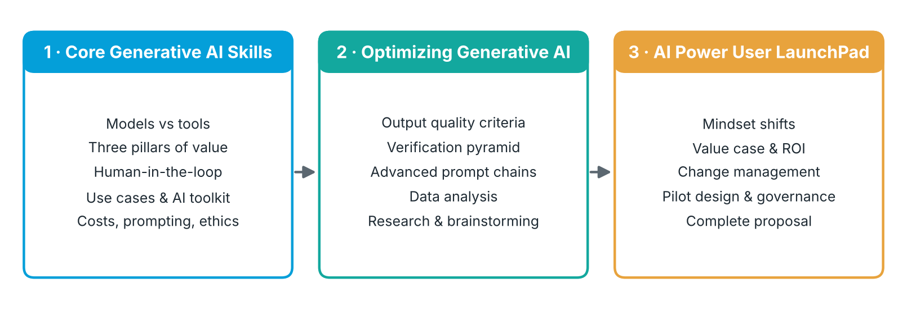<br>
  <em>Figure 1 — Structure of these notes along the AIBIZ learning journey</em>
</p>

**Table 1 — Skills Cisco lists for the AIBIZ Learning Path [S1]**

| Skill area | What the learner should be able to do |
|---|---|
| Generative AI tools | Understand LLMs, diffusion models and audio/code generation tools, with their capabilities and limitations |
| Platform selection | Select and evaluate AI platforms, chatbots, image generators and research tools on performance, security, compliance and cost |
| Prompting | Write clear, contextual, persona-based prompts and refine them iteratively, including advanced techniques for complex tasks |
| Content creation | Produce and refine text (emails, reports), visuals (graphics, marketing images) and audio (voiceovers) |
| Responsible use | Identify and mitigate algorithmic bias, respect data-privacy rules, protect sensitive information, set team AI-use policies |
| Output evaluation | Detect hallucinations, factual errors and bias; decide when to correct, refine or regenerate |
| Analysis & research | Use AI for exploratory data analysis, visualizations, pattern finding, hypotheses and structured research |
| APIs | Understand API concepts, authentication, key management and cost management for AI integration |
| Leadership | Build AI roadmaps, find high-value use cases, manage change, design pilots and champion adoption |

---

## Part 1 — Core Generative AI Skills

### 1.1 Learning objectives

- Describe common Generative AI models and tools, and identify practical business workflows where AI can be applied.
- Understand the crucial difference between a **model** and a **tool** (see Figure 3).
- Know when to use a **Large Language Model (LLM)** versus an **image generator**.
- Grasp the non-negotiable need for **human oversight**.
- Interact with a pre-selected LLM chatbot and an image generation tool to observe basic input/output behaviour.

### 1.2 The three pillars of AI business value

Generative AI creates business value in three ways. Each pillar answers a guiding question that helps decide where AI is worth applying.

<p align="center">
  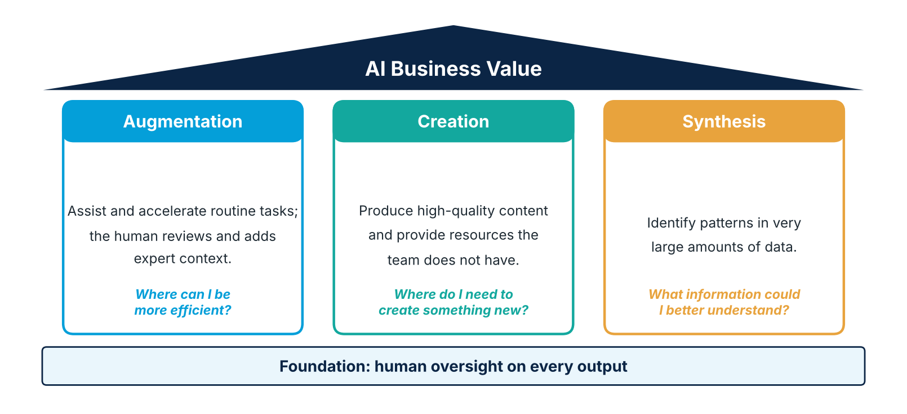<br>
  <em>Figure 2 — The three pillars of AI business value and their guiding questions</em>
</p>

**Table 2 — Three pillars of AI business value**

| Pillar | What AI does | Role of the human | Guiding question |
|---|---|---|---|
| **Augmentation** | Assists with and accelerates routine tasks | Reviews the output and adds expert context | *Where can I be more efficient?* |
| **Creation** | Produces high-quality content | Provides direction; fills resource gaps the team does not have | *Where do I need to create something new?* |
| **Synthesis** | Identifies patterns in very large amounts of data | Interprets the patterns and decides | *What information could I better understand?* |

### 1.3 AI models

**Model vs. tool.** A model is like an expert chef: it knows a great many recipes, but it needs the customer's order (your input) to cook anything useful. A tool is the "restaurant" built around the chef — the interface, features and controls people actually use.

<p align="center">
  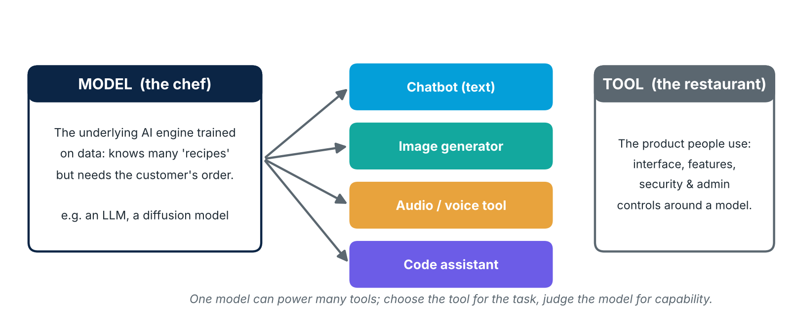<br>
  <em>Figure 3 — Model vs. tool: one underlying model can power many end-user tools</em>
</p>

**Cisco reference.** Cisco describes *foundation models* as large-scale AI systems trained on vast, diverse data (text, code, images, audio) that serve as a versatile base which can be fine-tuned for many downstream tasks [S7]. LLMs are one type of foundation model that focuses on processing and generating text; other foundation models handle images, audio or video, or are multimodal [S7]. Generative AI is the category of AI that creates new content, while foundation models are the technology that powers many generative AI applications [S7]. Unlike a search engine that lists results, an LLM answers with a fully composed natural-language response [S8].

**Model families and use cases (from the training):**

- **LLMs** — text: drafting, summarizing, organizing thoughts, answering questions.
- **Diffusion models** — well suited to **image** generation.
- **Audio** — text-to-speech, e.g. voiceovers for corporate training videos.
- **Code** — boosting software output.
- **Multimodality** — handling several input types (text, image, audio…) in one model.

**Table 3 — LLM or image generator?**

| If you need… | Use | Example |
|---|---|---|
| Words, structure, reasoning, summaries | LLM chatbot | Draft a project update for managers |
| A visual: illustration, concept image, banner | Image generator (diffusion model) | Concept visual for a campaign |
| Spoken audio from a script | Text-to-speech tool | Voiceover for a training video |
| Mixed inputs (e.g. describe a chart image) | Multimodal model | Summarize a screenshot of a dashboard |

### 1.4 Biases and the golden rule of AI in business

> **The golden rule of AI in business:** *Generative AI is a tool for augmentation, not replacement. The human user is always the final arbiter of quality, accuracy, and appropriateness. Every single output, no matter how minor, requires a "human-in-the-loop" for verification.*

Every output goes through four human checks:

<p align="center">
  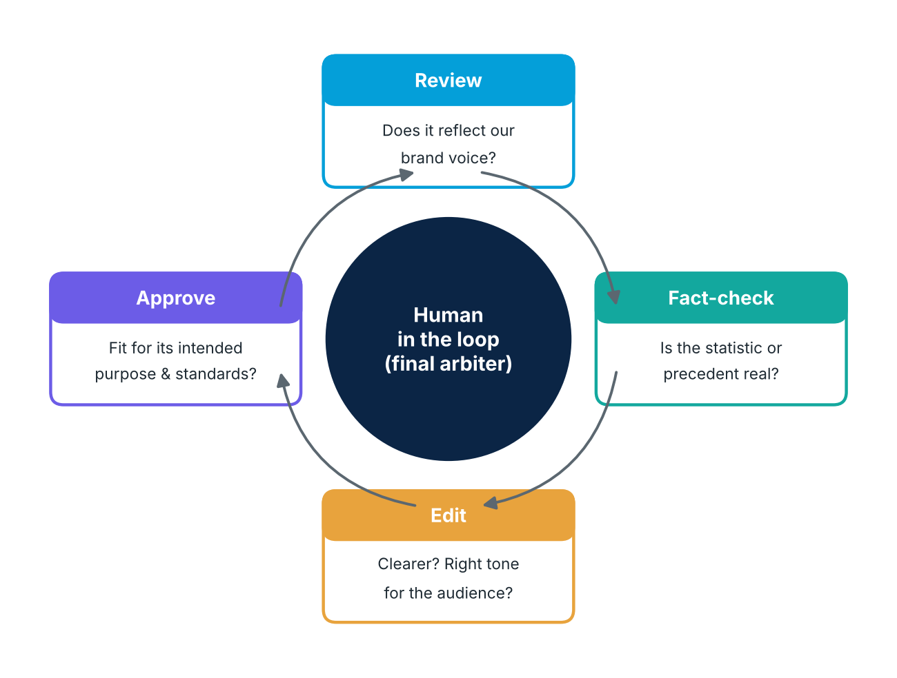<br>
  <em>Figure 4 — Human-in-the-loop review cycle</em>
</p>

**Table 4 — The four human-in-the-loop checks**

| Check | Key question |
|---|---|
| **Review** | Does this text accurately reflect our brand voice? |
| **Fact-check** | Is this statistic correct? Does this legal precedent actually exist? |
| **Edit** | Can this sentence be made clearer? Is the tone right for the audience? |
| **Approve** | Does this final product meet our standards and is it fit for its intended purpose? |

**Testing for bias (checklist).** The original notes left this point open; the checklist below is derived from Cisco's *Fairness* principle, which asks organizations to identify and remediate harmful bias in algorithms, training data and applications [S4]:

- [ ] Re-run the same prompt while changing only a demographic attribute (name, gender, region) and compare the outputs.
- [ ] Check whether examples, images or personas generated by default lack diversity.
- [ ] Ask what data the tool was trained on and whether it represents your audience.
- [ ] Look for loaded or stereotyped wording before publishing.

**Cisco reference.** Cisco notes that LLM quality depends on training data: errors or biases in that data can flow into answers, and LLMs can produce *hallucinations* — convincing but false answers — so they need ongoing management and monitoring [S8].

### 1.5 Practical Generative AI use cases

**Table 5 — Generative AI use cases by business function**

| Function | Use case | Pillar |
|---|---|---|
| **Customer support** | Intelligent ticket routing and summarization | Augmentation |
| | Drafting knowledge-base-informed responses | Creation |
| | Real-time sentiment analysis | Synthesis |
| **Marketing & content** | Personalized campaigns based on user data | Creation |
| | Repurposing content across formats | Creation |
| **Project management** | Drafting project plans | Creation |
| | Improving quality and tone (e.g. simplifying a complex engineering report) | Augmentation |
| | Extracting next actions from meetings | Synthesis |
| | Coordinating timelines and dependencies | Augmentation |

**Cisco reference.** Among common LLM applications, Cisco lists content generation from prompts, better translation, analysing customer input to give contextual responses, and chatbots or virtual assistants that streamline support [S8].

### 1.6 Build an AI toolkit

**Table 6 — Personal AI toolkit (tools named in the training)**

| Need | Tool category | Examples cited in the training |
|---|---|---|
| Organizing thoughts, drafting | LLM chatbot | General-purpose LLM assistant |
| Visuals | Image generator | Diffusion-based image tool |
| Information & fact-checking | AI search / answer engines | Perplexity, YouChat, scite (academic) |
| Data analysis | Computational engine | Wolfram Alpha |
| Research | Literature assistants | Elicit, [Iris.ai](https://iris.ai), Scholarcy |

> [!TIP]
> Before using any tool with company data, confirm it is on your organization's **approved tools** list (see 1.7 and 1.11).

### 1.7 Evaluating AI platforms

**Table 7 — Platform evaluation criteria**

| Criterion | Questions to ask |
|---|---|
| **Performance** | Is output quality good enough for the task? Is it fast and reliable? |
| **Security** | How is our data protected? Is it used to train the provider's models? |
| **Compliance** | Does it meet our privacy and regulatory obligations? |
| **Admin controls** | Can IT manage users, access, data retention and usage logs? |

**Cisco reference.** Cisco's AIBIZ description lists performance, security, compliance and economic factors as the basis for choosing AI platforms [S1]. Cisco's *Privacy* and *Security* principles add useful checks: personal data use should be purpose-aligned, proportional and fair, and systems should be tested regularly for resilience against attacks [S4].

### 1.8 Subscription vs. tokens

How to budget AI services:

<p align="center">
  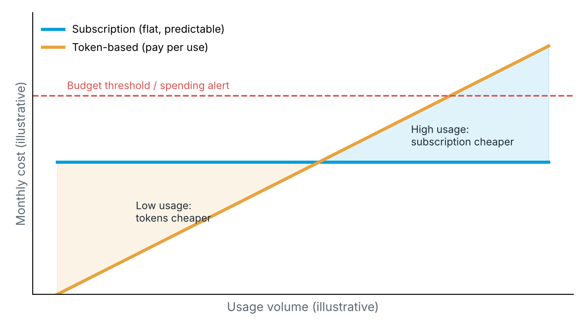<br>
  <em>Figure 5 — Subscription vs. token pricing (illustrative shape, not real prices)</em>
</p>

**Table 8 — Subscription vs. token-based pricing**

| | Subscription model | Token model |
|---|---|---|
| **Best for** | Sales, HR and other business teams | Developers and API integrations |
| **How you pay** | Same cost every period | Pay for what you consume; tokens (fragments of words the model processes) are billed for both the prompt **and** the answer |
| **Strengths** | Predictability; useful for high-volume usage | Efficiency; no paying for idle seats |
| **Weaknesses** | Can be inefficient when usage is low | Unpredictable bill → set a **budget threshold** |

**Strategies to save money with tokens:**

1. Add constraints to answers ("in 5 bullet points", "be concise").
2. Don't use premium models for simple tasks — compare alternatives, e.g. on the [Hugging Face model hub](https://huggingface.co/models).

**Cisco reference.** Cost management for integrating AI functionality through APIs — alongside authentication and key management — is part of the AIBIZ skill set [S1].

### 1.9 Prompt engineering

**Mindset:** the less detail in the prompt, the more *statistically average* the answer. The difference comes from the **context** you communicate.

<p align="center">
  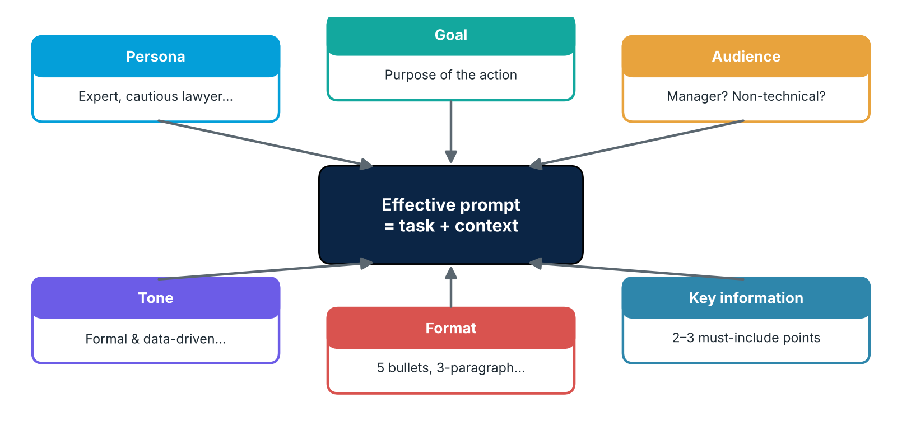<br>
  <em>Figure 6 — Anatomy of an effective prompt</em>
</p>

**Table 9 — Context elements of a prompt**

| Element | Purpose | Example |
|---|---|---|
| **Goal** | Why you need the output | "…to get budget approval for Q1" |
| **Target audience** | Who will read it | A manager? A non-technical stakeholder? |
| **Tone of voice** | How it should sound | Formal and data-driven; supportive and clear |
| **Format** | Shape of the output | Bullet points; 3-paragraph summary |
| **Key information** | What must be included | The 2 or 3 most important points |
| **Persona** | Who the AI should act as | Expert analyst, cautious lawyer… |

Then refine the output through a **cycle of conversation**, giving clear and detailed instructions at each turn.

**Example (built from the elements above):**

```text
Act as an experienced project manager (persona).
Write a status update for senior managers who are not technical (audience)
so they can approve a two-week delay (goal).
Tone: formal and data-driven (tone). Format: 3 short paragraphs (format).
Must include: the root cause, the new date, and the cost impact (key information).
```

### 1.10 Content generation

- Always check the **logic and overall consistency** of the generated content before using it.
- Apply the four human-in-the-loop checks (Table 4).

**Cisco reference.** AIBIZ covers creating and refining text (emails, reports), visual content (graphics, marketing images) and audio content (voiceovers) with AI tools [S1].

### 1.11 Ethical principles and security

**Ethical principles from the training:**

- **Fairness and algorithmic bias** — look at the data used to train the AI.
- **Human accountability** — people, not the AI, are accountable for outcomes.
- **Transparency** about when AI is used.
- **Respect for intellectual property.**

**Cisco reference.** Cisco organizes responsible AI around six principles — transparency, fairness, accountability, privacy, security and reliability — and recommends combining Security by Design, Privacy by Design and Human Rights by Design [S4][S5]. Its Responsible AI Framework is aligned with the NIST AI Risk Management Framework [S4] and is governed by a Responsible AI Committee of senior executives, with controls and incident management built in [S6].

<p align="center">
  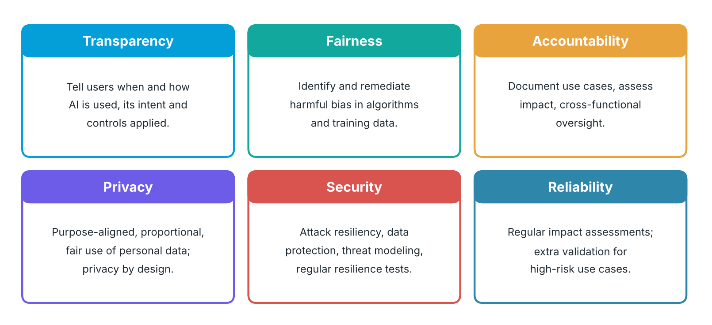<br>
  <em>Figure 7 — Cisco's six Responsible AI principles (summarized from [S4])</em>
</p>

**Security against prompt injection (from the training):**

- Use **approved tools** only.
- Keep a **human in the loop**.
- When you paste text, ask the AI to **summarize it first** (to surface hidden instructions).
- **Limit** what the assistant can process at the start.

**Cisco reference.** Splunk (a Cisco company) defines prompt injection as hiding instructions inside text so that an AI tool ignores its intended guidelines, leaks sensitive data or takes unintended actions [S9].

**Table 10 — Direct vs. indirect prompt injection [S9]**

| Aspect | Direct | Indirect |
|---|---|---|
| How it works | Attacker types malicious instructions into the prompt | Instructions are hidden in content the AI processes later (web page, file, email) |
| Visibility | Visible in the conversation | Hidden in retrieved or pasted content |
| Detection | Easier to spot | Harder to detect |
| Business takeaway | Train users; use approved tools | Summarize and inspect external content before acting on it |

---

## Part 2 — Optimizing Generative AI

### 2.1 Evaluation criteria

**Table 11 — Quality dimensions for AI outputs**

| Quality dimension | Definition | Business impact of failure |
|---|---|---|
| **Accuracy** | Is the information factually correct, verifiable and up to date? | **High.** Leads to poor strategic decisions, legal liability and loss of credibility. An inaccurate report is worse than no report at all. |
| **Coherence** | Is the output logical, fluent and grammatically correct? Does it make sense? | **Medium.** Poor coherence makes content unusable and reflects poorly on the user, but it is often easy to spot and discard. |
| **Relevance** | Does the output directly address the specific intent and context of the prompt? | **High.** Irrelevant output wastes time and fails to solve the business problem, even if accurate and well written. |

**Cisco reference.** AIBIZ trains learners to detect hallucinations, factual errors and biases, and to decide whether to correct, refine or regenerate content [S1].

### 2.2 The verification pyramid

Climb the pyramid as the stakes of the decision increase.

<p align="center">
  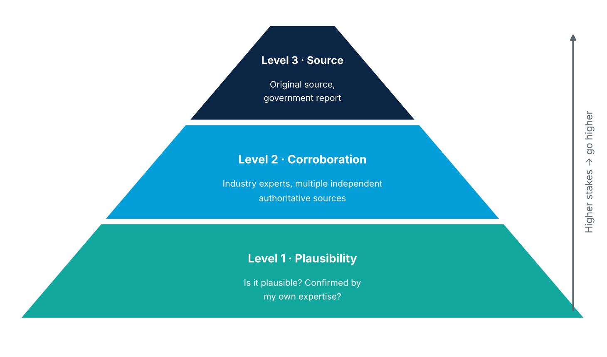<br>
  <em>Figure 8 — The verification pyramid</em>
</p>

**Table 12 — Verification levels**

| Level | Question | When it is enough |
|---|---|---|
| **1 — Plausibility** | Is the output plausible? Is it confirmed by my own expertise? | Low-stakes internal drafts |
| **2 — Corroboration** | Do industry experts confirm it? Do multiple independent, authoritative sources agree? | Shared documents, recommendations |
| **3 — Primary source** | Can I trace it to the original source (e.g. a government report)? | Decisions, legal, financial or public claims |

### 2.3 Advanced prompt engineering

Principle: **smaller → manageable → sequential.** Divide the whole analysis into smaller tasks; each task is a separate, verified prompt whose output becomes the input for the next step.

<p align="center">
  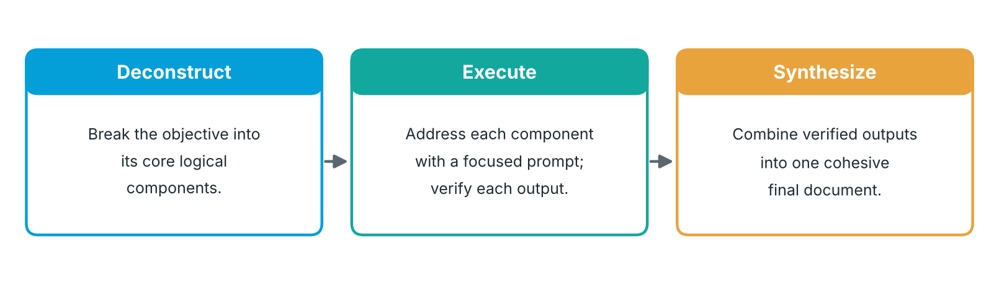<br>
  <em>Figure 9 — Prompt chaining: Deconstruct → Execute → Synthesize</em>
</p>

| Phase | Action |
|---|---|
| **Deconstruct** | Break the objective into its core logical components |
| **Execute** | Address each component with a focused prompt |
| **Synthesize** | Combine the outputs into a single, cohesive final document |

**Checklist** (the notes left this open; items are derived from the phases above):

- [ ] Is the overall objective written down in one sentence?
- [ ] Is each component small enough for one focused prompt?
- [ ] Was each intermediate output verified (Table 11, Figure 8) before being reused?
- [ ] Does the final synthesis stay consistent with every verified component?

### 2.4 Data analysis

Goal: transform unstructured text (e.g. customer feedback) into actionable insight.

<p align="center">
  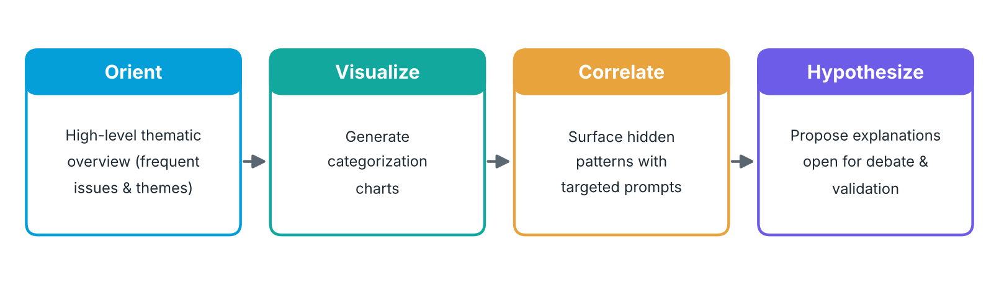<br>
  <em>Figure 10 — AI-assisted data analysis workflow</em>
</p>

1. **Orient** — high-level thematic overview (e.g. most frequently mentioned issues and themes).
2. **Visualize** — generate categorization charts.
3. **Correlate** — identify hidden patterns with targeted prompts.
4. **Hypothesize** — propose explanations that remain open for debate.

Finally, ask the AI for **key takeaways** to tell the story behind the data.

**Cisco reference.** AIBIZ covers exploratory data analysis, generating visualizations, identifying patterns, formulating hypotheses and synthesizing information with AI [S1].

### 2.5 AI for research and brainstorming

**Before relying on a tool for research, check:**

- **Information access** — does the tool have a knowledge cutoff? Can it search current sources?
- **Source citation** — mandatory.
- **Information strengths** — what is the model's training data? Is it strong on scientific papers?

**Brainstorming framework:**

<p align="center">
  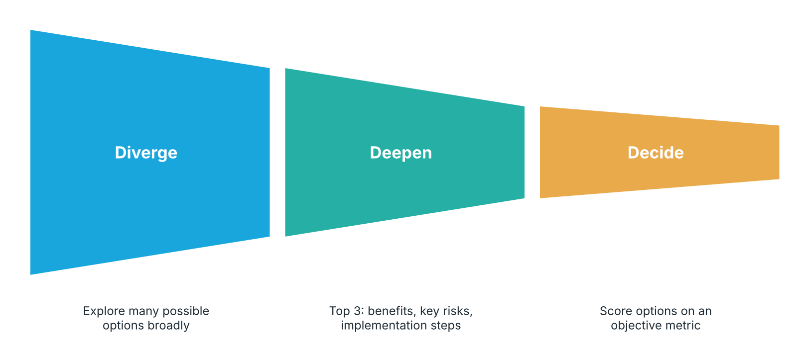<br>
  <em>Figure 11 — Diverge → Deepen → Decide</em>
</p>

| Step | Action |
|---|---|
| **Diverge** | Explore possible options broadly |
| **Deepen** | Select the top 3 and analyse benefits, key risks and implementation steps |
| **Decide** | Build an objective metric to evaluate the shortlisted options |

---

## Part 3 — AI Power User LaunchPad

### 3.1 Pitfalls to avoid

<p align="center">
  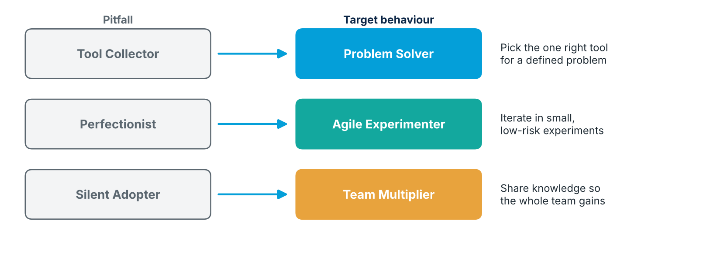<br>
  <em>Figure 12 — From pitfall to target behaviour</em>
</p>

| Pitfall | Target behaviour | Meaning |
|---|---|---|
| Tool collector | **Problem solver** | One right tool for a defined problem |
| Perfectionist | **Agile experimenter** | Iterate quickly through small experiments |
| Silent adopter | **Team multiplier** | Share knowledge so the team benefits |

### 3.2 Design phases to become an AI champion

<p align="center">
  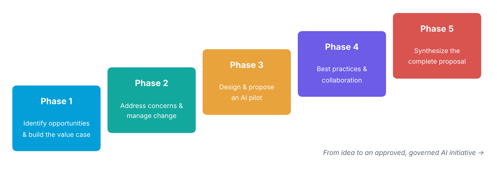<br>
  <em>Figure 13 — The five phases of an AI champion's proposal</em>
</p>

**Cisco reference.** The leadership part of AIBIZ focuses on personal AI integration roadmaps, high-value use cases, change management, pilot design, best practices and championing AI innovation [S1].

#### Phase 1 — Identify opportunities and build the value case

- Quantify benefits: time saved, operational value in money, strategic value.
- Calculate the ROI:

  **ROI = (Net Benefit − Cost) / Cost × 100 %**

  *Worked example (illustrative figures):* a tool costs 10,000 per year and saves time worth 25,000 per year → ROI = (25,000 − 10,000) / 10,000 × 100 % = **150 %**. Here "Net Benefit" means the total benefit before costs; if your benefit figure already has costs deducted, use Benefit / Cost × 100 % instead.
- Communicate the value to stakeholders.

#### Phase 2 — Address concerns and manage change

- Evaluate team readiness.
- Address common concerns: job security, skill adequacy, quality of output.
- Build a training and participative support plan.

#### Phase 3 — Design and propose an AI pilot project

- Define the pilot scope.
- [Select tools with enterprise criteria](https://ondemandelearning.cisco.com/apollo-alpha/ai-biz-integratingaiintoorg-10/pages/6) (see Table 7).
- Establish success metrics.

#### Phase 4 — Establish best practices and foster collaboration

- Human accountability + guarding against bias + transparency + security (see Figure 7).
- Data classification protocol (what data may and may not be shared with AI tools).
- Quality assurance (see Table 11 and Figure 8).

**Cisco reference.** Cisco's accountability guidance includes documenting AI use cases, conducting impact assessments and providing cross-functional oversight, with an open channel for employees to raise concerns [S4].

#### Phase 5 — Synthesize the complete proposal

**Table 13 — Structure of the final AI proposal (course example: "Project Catalyst")**

| # | Section | Content |
|---|---|---|
| 1 | Executive summary | The opportunity, the ask and the expected return in a few lines |
| 2 | Business context and opportunity | Problem, current process, pillar addressed (Figure 2) |
| 3 | Proposed initiative: Project Catalyst | Pilot scope, tools selected, success metrics |
| 4 | Financial analysis | Costs, benefits, ROI (Phase 1), pricing model (Table 8) |
| 5 | Change management and governance | Readiness, training plan, responsible-AI practices |
| 6 | Risk assessment | Accuracy, bias, privacy, security, prompt injection |
| 7 | Long-term vision | How the pilot scales across the organization |
| 8 | Appendices | Supporting data, tool evaluations, references |

---

## Appendix A — Glossary

| Term | Definition |
|---|---|
| **Diffusion model** | Generative model family well suited to image creation |
| **Foundation model** | Large model trained on broad data that can be adapted to many tasks [S7] |
| **Hallucination** | A convincing but false answer produced by a model [S8] |
| **Human-in-the-loop** | A person reviews, fact-checks, edits and approves every AI output |
| **LLM** | Large Language Model — a foundation model focused on text [S7][S8] |
| **Multimodality** | Ability to handle several input types (text, image, audio…) |
| **Prompt injection** | Hidden instructions that make an AI ignore its intended guidelines [S9] |
| **Token** | Fragment of a word processed by a model; the billing unit for usage-based pricing |

## Appendix B — Sources

| Ref | Source |
|---|---|
| [S1] | Cisco — [Cisco AI Business Practitioner (AIBIZ)](https://www.cisco.com/site/us/en/learn/training-certifications/training/courses/aibiz.html) |
| [S2] | Cisco Blogs — [AI as a Team Sport: New Cisco U. Learning Paths for Business and Tech Leaders](https://blogs.cisco.com/learning/ai-learning-paths-for-business-and-tech-pros) (Nov 3, 2025) |
| [S3] | Cisco Blogs — [Learn with Cisco Introduces New AI Training](https://blogs.cisco.com/learning/learn-with-cisco-introduces-new-ai-training) |
| [S4] | Cisco — [What is responsible AI?](https://www.cisco.com/site/us/en/learn/topics/artificial-intelligence/what-is-responsible-ai.html) |
| [S5] | Cisco — [Principles for Responsible Artificial Intelligence (PDF)](https://www.cisco.com/c/dam/en_us/about/doing_business/trust-center/docs/cisco-responsible-artificial-intelligence-principles.pdf) |
| [S6] | Cisco — [The Cisco Responsible AI Framework (PDF)](https://www.cisco.com/c/dam/en_us/about/doing_business/trust-center/docs/cisco-responsible-artificial-intelligence-framework.pdf) |
| [S7] | Cisco — [What are foundation models?](https://www.cisco.com/site/us/en/learn/topics/artificial-intelligence/what-are-foundation-models.html) |
| [S8] | Cisco — [What is a large language model?](https://www.cisco.com/site/us/en/learn/topics/artificial-intelligence/what-is-large-language-model-llm.html) |
| [S9] | Splunk, a Cisco company — [What is prompt injection?](https://www.splunk.com/en_us/blog/learn/prompt-injection.html) (Nov 3, 2025) |
| [S10] | Cisco Learning Network Store — [Cisco AI Business Practitioner (AIBIZ) v1.0](https://learningnetworkstore.cisco.com/on-demand-e-learning/cisco-ai-business-practitioner-aibiz-v1.0/CSCU-LP-AIBIZ-V1-029961.html) |
| — | Cisco U. — [AIBIZ Learning Path](https://u.cisco.com/paths/cisco-ai-business-practitioner-20706) |

## Appendix C — List of figures and tables

**Figures**

| # | Title | Section |
|---|---|---|
| Figure 1 | Structure of these notes along the AIBIZ learning journey | 0 |
| Figure 2 | The three pillars of AI business value and their guiding questions | 1.2 |
| Figure 3 | Model vs. tool: one underlying model can power many end-user tools | 1.3 |
| Figure 4 | Human-in-the-loop review cycle | 1.4 |
| Figure 5 | Subscription vs. token pricing (illustrative) | 1.8 |
| Figure 6 | Anatomy of an effective prompt | 1.9 |
| Figure 7 | Cisco's six Responsible AI principles | 1.11 |
| Figure 8 | The verification pyramid | 2.2 |
| Figure 9 | Prompt chaining: Deconstruct → Execute → Synthesize | 2.3 |
| Figure 10 | AI-assisted data analysis workflow | 2.4 |
| Figure 11 | Diverge → Deepen → Decide | 2.5 |
| Figure 12 | From pitfall to target behaviour | 3.1 |
| Figure 13 | The five phases of an AI champion's proposal | 3.2 |

**Tables**

| # | Title | Section |
|---|---|---|
| Table 1 | Skills Cisco lists for the AIBIZ Learning Path | 0 |
| Table 2 | Three pillars of AI business value | 1.2 |
| Table 3 | LLM or image generator? | 1.3 |
| Table 4 | The four human-in-the-loop checks | 1.4 |
| Table 5 | Generative AI use cases by business function | 1.5 |
| Table 6 | Personal AI toolkit | 1.6 |
| Table 7 | Platform evaluation criteria | 1.7 |
| Table 8 | Subscription vs. token-based pricing | 1.8 |
| Table 9 | Context elements of a prompt | 1.9 |
| Table 10 | Direct vs. indirect prompt injection | 1.11 |
| Table 11 | Quality dimensions for AI outputs | 2.1 |
| Table 12 | Verification levels | 2.2 |
| Table 13 | Structure of the final AI proposal | 3.2 |
